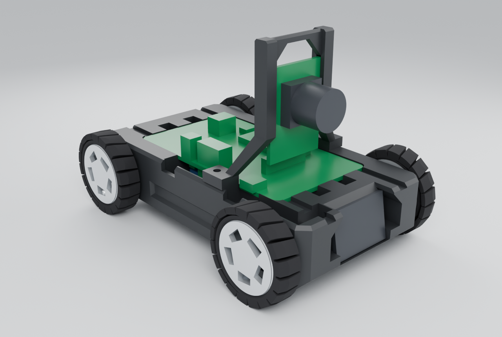
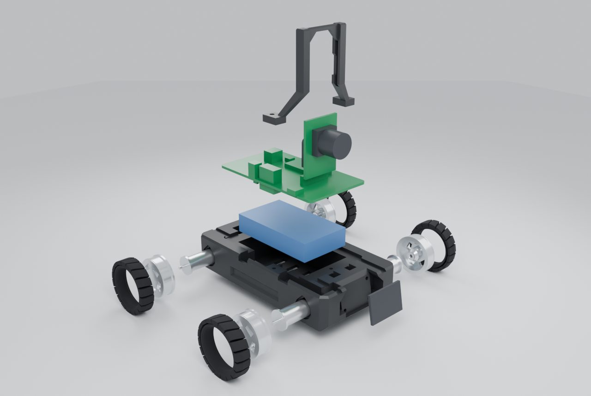

# SmartRover — 3D Printing & Hardware

| Assembled | Exploded |
| :---: | :---: |
|  |  |

Parametric unibody chassis, optional open-back camera brace, and 2-piece wheels generated with `build123d` ([mechanical/cad/parts.py](../mechanical/cad/parts.py)) for the 45 × 80 mm main PCB ([SmartRover.kicad_pcb](../hardware/SmartRover.kicad_pcb)) and UC-367 Arducam Mini (24.3 × 34.1 mm).

- **Dimensions:** 80.4 × 122.0 × 69.6 mm overall (79.5 mm tall with camera brace; 62.0 × 115.5 × 22.0 mm chassis), 88.0 mm wheelbase, 8.0 mm ground clearance, 34.0 × 8.0 mm wheels (Ø 2.0 mm crush-ribbed shaft bore).
- **Battery Bay:** 35.0 × 62.0 mm under-PCB bay (~15 mm clear beneath solder pins; verified for 34 × 60 × 12 mm 1S LiPo packs such as 603048 / 803048 / 103450) with floor strap slots and direct `J102` lead routing.
- **Interactive Inspection *(do not print)*:** [`SmartRover_Assembled.step`](SmartRover_Assembled.step) · [`SmartRover_Exploded.step`](SmartRover_Exploded.step)

## Print Settings

- **Supports:** None — all parts are pre-oriented flat on `Z = 0` (45° teardrop motor bores, +10° self-supporting recessed ToF nose, open-top wire gutters).
- **Format:** Prefer [`step/`](step/) over [`stl/`](stl/) for smooth small bores (Ø 2.0 mm / Ø 2.2 mm / Ø 10.15 mm).
- **Rigid (PLA / PLA+ / PETG):** 0.20 mm layers; 3 walls / 15% Adaptive Cubic infill for the chassis (4 walls on `02_wheel_rim_x4` for crush ribs; optional 3–5 mm outer brim on `03_camera_brace_optional`).
- **Tires (TPU 95A):** 0.20 mm layers, 2–3 walls, 15% infill (print from external spool, not AMS).

## Files

| Files | Qty | Material | Description |
| :--- | :---: | :--- | :--- |
| [`SmartRover_RigidPrintPlate.step`](SmartRover_RigidPrintPlate.step) ([`.stl`](SmartRover_RigidPrintPlate.stl)) | 1 plate (6 parts) | PLA / PETG | All rigid parts (01–03) pre-arranged (123 × 119 mm, fits 180 × 180 mm mini beds) |
| [`step/01_unibody_chassis.step`](step/01_unibody_chassis.step) ([`.stl`](stl/01_unibody_chassis.stl)) | 1× | PLA / PETG | Single-piece unibody chassis with battery bay, teardrop motor bores, recessed +10° ToF nose, Qwiic gutter & LED slits |
| [`step/02_wheel_rim_x4.step`](step/02_wheel_rim_x4.step) ([`.stl`](stl/02_wheel_rim_x4.stl)) | 4× | PLA / PETG | Closed-hub 5-spoke Ø 34 mm wheel rims |
| [`step/03_camera_brace_optional.step`](step/03_camera_brace_optional.step) ([`.stl`](stl/03_camera_brace_optional.stl)) | 1× *(optional)* | PLA / PETG | Open-back bolt-on Arducam UC-367 stabilizer (clears rear heatsink & M2 screws; drops over installed camera) |
| [`step/04_wheel_tire_tpu_x4.step`](step/04_wheel_tire_tpu_x4.step) ([`.stl`](stl/04_wheel_tire_tpu_x4.stl)) | 4× | **TPU 95A** | Slip-on chevron tires |

## Hardware BOM

- **4× Rubber Grommets:** QUARKZMAN 10 mm OD × 6 mm ID × 11 mm flanged grommets (press cleanly into the flush outer counterbores from outside to sleeve 6–7 mm motors and damp camera/IMU vibration; bare 10 mm motors also fit directly)
- **4–8× M2.5 × 6–8 mm screws** (self-tapping into Ø 2.2 mm pilots):
  - 2× main PCB (`H201` / `H202`)
  - 2–4× Adafruit VL53L0X STEMMA QT (PID 3317) → recessed +10° front nose pocket
  - 2× *(optional)* camera brace → top chassis rim
- **4× M2.5 × 4 mm screws *(optional, bare 10 mm motors only)*:** Bottom radial lock-screws for motor bores

## Assembly Notes

1. **Grommets & motors *(wheels off)*:** Push the four rubber grommets into the flush outer counterbores from outside, feed each motor's wire pair through the bore into the open 6 × 7 mm chimney right outside the PCB edge, and slide the motor home.
2. **VL53L0X & Qwiic cable:** Plug a 50–100 mm Qwiic/STEMMA QT cable into the right-side VL53L0X port, screw the sensor into the recessed +10° front pocket, and drop the cable into the open-top right gutter leading to `J310`.
3. **Battery & PCB:** Drop the 1S LiPo into the central bay (use the floor strap slots for smaller packs), pass its JST-PH plug up through the right-side `J102` pocket, and bolt the main PCB down (`H201`/`H202`).
4. **Motor wiring & connectors:** Fold the four motor wire pairs over the PCB edges onto FL (`J301`/`J302`), FR (`J303`/`J304`), RL (`J305`/`J306`), and RR (`J307`/`J308`), plug in `J102` and `J310`, and verify forward spin direction.
5. **Optional camera brace:** Plug the Arducam UC-367 into `J309`; for extra support, drop `03_camera_brace_optional` straight down over the camera PCB and secure with 2× M2.5 × 8 mm screws.
6. **Wheels & tires:** Seat the wider inner TPU tire groove over the larger chassis-side rim flange (matching left/right chevron tread direction) and press rims onto the Ø 2.0 mm shafts leaving the 1.2 mm hub standoff clear of the chassis.

---

To verify clearances or regenerate exports from source (`make cad-verify` / `make cad-export`), see [mechanical/README.md](../mechanical/README.md).
