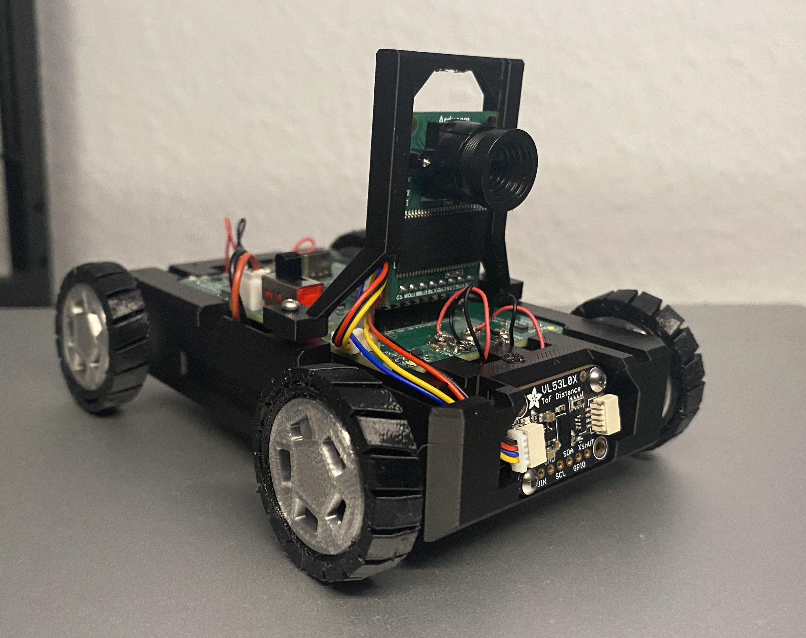
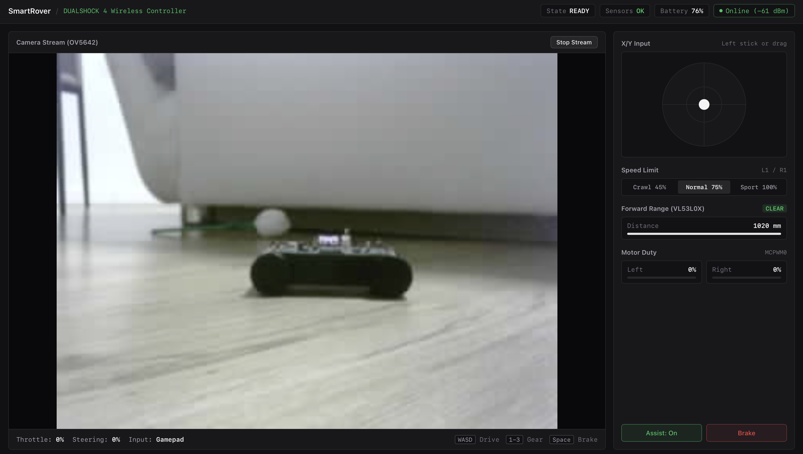

# SmartRover



SmartRover is a teleoperated 4WD mobile robot built on the **ESP32-S3** in `no_std` asynchronous Rust (`embassy` + `esp-hal`). The repository includes the firmware, an embedded single-file web cockpit, KiCad PCB/manufacturing files, and parametric `build123d` mechanical models.

## Overview

- **Drive & Camera:** Differential 4WD skid-steer (4× A3908EEETR-T H-bridges on `MCPWM0` in paired left/right banks, no wheel encoders) + SPI Arducam OV5642 MJPEG stream on Core 1.
- **Browser Teleoperation:** Web Gamepad API (PlayStation, Xbox, and standard controllers), `WASD`/arrow keys, and touch/mouse X/Y pad.
- **Onboard Safety Supervision:**
  - **Obstacle Assist (VL53L0X):** 3-sample median-filtered ranging scales forward throttle below 320 mm, latches forward stop at <= 140 mm (165 mm release hysteresis; reverse and pivot steering remain allowed), and filters invalid or weak signal returns to ignore grazing floor reflections.
  - **Tilt & Free-Fall (BMI323):** Latches motor cutoff past 0.68 g for 400 ms or on free-fall; recovers once upright with neutral sticks.
  - **Watchdog & Battery (`ADC1`):** Cuts drive output after 600 ms without a control packet or below 15% battery (20% hysteresis).

## Project Structure

- [`src/`](src/) — ESP32-S3 firmware (`domain/` control & safety logic, `adapters/` tasks & shared state, `drivers/` for MCPWM0, BMI323, VL53L0X, OV5642, and ADC1, `camera/` Core 1 capture, `network/` Wi-Fi/DHCP/HTTP/MJPEG server).
- [`dashboard/`](dashboard/) — Single-file web cockpit (`dashboard.html.gz`) embedded into firmware flash.
- [`hardware/`](hardware/) — KiCad schematics, 4-layer PCB (45 × 80 mm), and [`hardware/manufacturing/`](hardware/manufacturing/) fabrication files (BOM, Gerbers, pick-and-place).
- [`mechanical/`](mechanical/) & [`3d-printing/`](3d-printing/) — Parametric `build123d` CAD sources and support-free printable STEP/STL files (62.0 × 115.5 mm unibody chassis).

## Controls



| Function | Gamepad | Keyboard | Touch / Mouse |
| :--- | :--- | :--- | :--- |
| **Throttle** | Left Stick Y or R2 / L2 Triggers | `W` / `S` or `Up` / `Down` | Drag pad vertically |
| **Steering** | Left Stick X or Right Stick X | `A` / `D` or `Left` / `Right` | Drag pad horizontally |
| **Speed Gear** | `LB` / `RB` (`L1` / `R1`) | `1`, `2`, `3` | Click Crawl / Normal / Sport |
| **Brake** | `B` (Circle) | `Space` | Hold Brake button |
| **Obstacle Assist** | `Y` (Triangle) | — | Click Assist button |

## Pinout (ESP32-S3-MINI-1)

| Subsystem | GPIO | Peripheral | Notes |
| :--- | :---: | :---: | :--- |
| **I2C Bus** | `8` (SDA), `9` (SCL) | `I2C0` | 400 kHz (BMI323, VL53L0X, OV5642) |
| **Camera SPI** | `34` (CS), `35` (MOSI), `36` (SCK), `37` (MISO) | `SPI2` | 8 MHz FIFO burst read on Core 1 |
| **Motors** | `11`, `12` (Left), `13`, `14` (Right) | `MCPWM0` | 16 kHz PWM to A3908 H-bridges |
| **Battery Sense** | `1` | `ADC1` | 2:1 voltage divider (3.3 V to 4.2 V) |
| **Status LEDs** | `3`, `4`, `5`, `6` | `GPIO` | Front White (`3`, `4`), Rear Red (`5`, `6`) state, ADAS, and fault indicators |

## Building and Testing

### Prerequisites
- **Rust (`esp` toolchain):** `channel = "esp"` ([`rust-toolchain.toml`](rust-toolchain.toml)) targeting `xtensa-esp32s3-none-elf` via `espup`, plus `espflash`.
- **Node.js & npm:** For `dashboard/` tests and asset bundling (`dashboard/dashboard.html.gz`).
- **`uv` *(optional, CAD only)*:** For verifying or regenerating 3D models in [`mechanical/`](mechanical/README.md).

### Test, Build & CAD Commands

```bash
# Run Rust host unit tests + dashboard unit tests (no ESP32-S3 required)
make test

# Run the full local CI suite (fmt, tests, dashboard bundle check, clippy, ESP32-S3 builds)
make ci

# Rebuild dashboard/dashboard.html.gz after editing dashboard/ (or `cd dashboard && npm run dev`)
make dashboard

# Verify clearances & regenerate STLs/STEPs in 3d-printing/
make cad-verify && make cad-export
```

### Flash to ESP32-S3

Connect a 3.3 V USB-UART bridge to `J201` (onboard USB-C is power-only), switch battery power **ON**, and enter download mode (**hold `BOOT`, press `RESET`, release `BOOT`**):

```bash
# Default SoftAP mode (SmartRover_AP / smartrover123 -> http://192.168.4.1/)
make dashboard && make flash PORT=/dev/cu.usbserial-0001

# Station (STA) mode (joins 2.4 GHz Wi-Fi; compile-time when WIFI_SSID is set)
make flash-sta WIFI_SSID="Your_2.4GHz_SSID" WIFI_PASS="Your_Password" PORT=/dev/cu.usbserial-0001
```

- **Port & baud overrides:** Omit `PORT=...` to auto-select, or override defaults (`--before no-reset -B 115200`) with `FLASH_BEFORE=default-reset BAUD=460800`.
- **Wi-Fi mode:** Selected at compile time via `WIFI_SSID`. In STA mode, the rover retries every 5 s without falling back to SoftAP and prints its assigned cockpit URL on serial (`Rover Cockpit: http://<ip>/`).

See [`mechanical/README.md`](mechanical/README.md) and [`3d-printing/README.md`](3d-printing/README.md) for CAD and printing details.

## HTTP API

| Endpoint | Description |
| :--- | :--- |
| `GET /` | Serves the gzip-compressed web cockpit (`dashboard.html.gz`). |
| `POST /control?t=&s=&g=&b=&a=` | Updates throttle/steering (`-1000..=1000`), gear (`1..=3`), brake (`0`/`1`), and obstacle assist (`0`/`1`); returns status JSON. |
| `GET /status` | Returns telemetry JSON (`dist`, `batt`, `state`, `adas_active`, `left_pwm`, `right_pwm`, `rssi`, `tof_ok`, `imu_ok`). |
| `GET /stream` | Multipart MJPEG camera stream (`multipart/x-mixed-replace; boundary=frame`; single active viewer, new connections preempt older ones). |

## License

MIT License. See [LICENSE](LICENSE).
