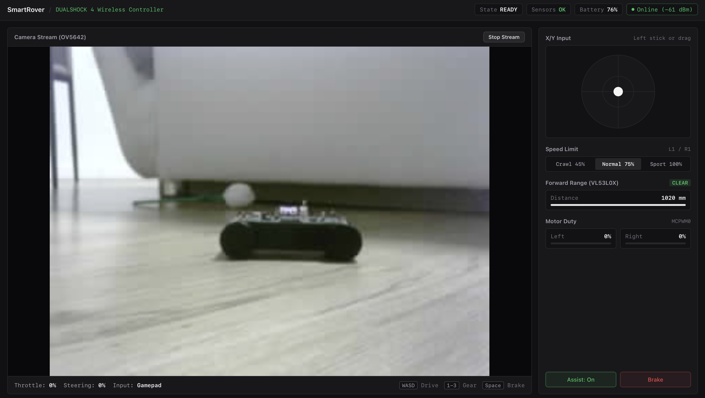

# SmartRover Dashboard



Web UI for driving SmartRover (gamepad, keyboard, or touch) and viewing the live MJPEG camera feed.

`npm run compress` bundles everything into a single gzipped file (`dashboard.html.gz`) that the ESP32-S3 firmware embeds directly into flash.

## Development

```bash
npm install
npm test                              # Unit tests
npm run dev                           # Dev server (proxies to http://192.168.4.1)
ROVER_HOST=192.168.1.50 npm run dev   # Proxy to a rover on your LAN
npm run compress                      # Rebuild dashboard.html.gz for the firmware
```
