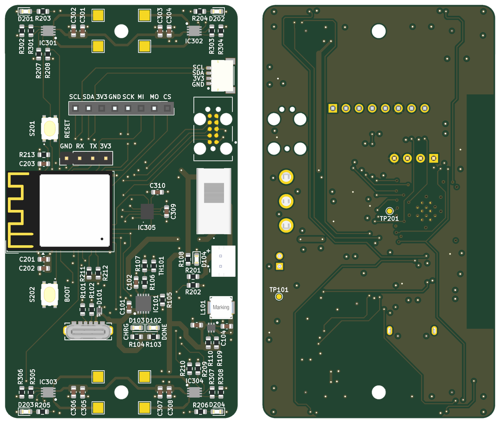

# SmartRover Hardware & PCB

4-layer 1.6 mm FR4 carrier board (45 × 80 mm) designed in **KiCad 9.0+**.

- **Schematics (PDF):** [`schematics.pdf`](schematics.pdf)
- **KiCad Project:** [`SmartRover.kicad_pro`](SmartRover.kicad_pro), [`SmartRover.kicad_pcb`](SmartRover.kicad_pcb), and [`SmartRover.kicad_sch`](SmartRover.kicad_sch) linking:
  - [`PowerSupply.kicad_sch`](PowerSupply.kicad_sch) — MCP73833 LiPo charger (`IC101`), MP2153 3.3 V buck (`IC102`), USB-C power input (`J101`), JST-PH battery (`J102`), SPDT charge/run switch (`S101`).
  - [`Microcontroller.kicad_sch`](Microcontroller.kicad_sch) — ESP32-S3-MINI-1-N8 (`U201`), UART header (`J201`), Tag-Connect JTAG (`J202`), RESET/BOOT buttons (`S201`/`S202`), status LEDs.
  - [`SensorActuator.kicad_sch`](SensorActuator.kicad_sch) — 4× A3908 motor drivers (`IC301–IC304`), BMI323 IMU (`IC305`), Arducam header (`J309`), JST-SH I2C/ToF header (`J310`).
- **Manufacturing:** [`manufacturing/`](manufacturing/) (`BOM.csv`, `Gerbers.zip`, `Position-file.csv`).

All symbols and footprints are embedded inside the schematic and PCB files, so you can inspect the design and re-export fabrication outputs in KiCad 9.0+ without external libraries. (Custom third-party libraries referenced in [`sym-lib-table`](sym-lib-table) / [`fp-lib-table`](fp-lib-table) are only needed if you update symbols/footprints from libraries.)
